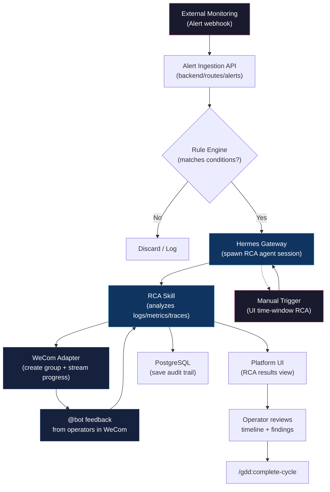

# Design Context — 六脉智能化运维数智平台

## Project Overview

**Name:** 六脉 (Liumai) — 智能化运维数智平台 (Intelligent Operations Digital Platform)

**Type:** B2B Operations Platform (Web Application)

**Elevator Pitch:** An AI-powered operations platform that automates fault root cause analysis (RCA) and emergency collaboration via a multi-agent architecture, integrated with private WeChat Work (企业微信) for real-time incident coordination.

## Domain

- **Primary:** DevOps / AIOps (intelligent IT operations)
- **Secondary:** Incident Management, Emergency Response Collaboration
- **Tertiary:** Multi-Agent Systems, Enterprise Messaging Integration

## Core Features

### Feature 1: 故障定界 (Fault Delimitation / RCA)

Two trigger modes:

1. **Passive Trigger (Event-Driven)**
   - Platform receives alert data from external monitoring systems
   - Operators configure rule conditions (e.g., alert severity, service name patterns, time windows)
   - When conditions are met → automatically invokes RCA skill on Hermes agent
   - Agent performs multi-step root cause analysis

2. **Active Trigger (Human-Initiated)**
   - Operator selects "RCA Scenario" in the platform UI
   - Specifies a time window (absolute range or relative, e.g., "last 30 minutes")
   - System invokes RCA skill on Hermes agent for the specified window

**RCA Process:**
- Agent analyzes logs, metrics, traces, and topology data
- Produces structured fault delimitation results (root cause, impact scope, evidence chain)
- Results surfaced in UI and pushed to emergency collaboration channel

### Feature 2: 应急协同 (Emergency Collaboration)

- Triggered simultaneously with fault delimitation
- Auto-creates a WeChat Work (企业微信) group chat via Hermes WeCom adapter
- RCA investigation progress is automatically streamed to the group
- Group members can @mention the intelligent bot to report manual investigation progress
- Bot captures manual inputs and feeds them into the RCA context
- Full bidirectional: agent → group (progress updates) and group → agent (human feedback)

### Cross-Cutting Requirements

- **Historical Records:** Complete audit trail of every RCA process and collaboration event
- **Multi-Agent Architecture:** Powered by Hermes Agent as the agent runtime
- **WeCom Integration:** Private deployment of 企业微信 (WeChat Work), using Hermes WeCom Bot (WebSocket) adapter
- **Simple/Minimal UI:** Clean, modern interface — operator-focused, not cluttered

## Technical Stack

### Agent Layer
- **Runtime:** Hermes Agent (by Nous Research)
- **Integration Pattern:** Hermes Plugin + Skills + Gateway
- **Skills to Build:** `rca-fault-delimitation` (RCA skill with pluggable data-source adapters)
- **Gateway:** Hybrid — 企业微信自建应用 API (group creation) + Hermes WeCom Bot WebSocket (in-group messaging)
- **Data Sources:** Internal centralized monitoring platform, 日志易 (log analysis), ClickHouse (metrics/transactions)
- **Max Concurrency:** 5 RCA sessions (configurable)

### Frontend
- **Framework:** React with TypeScript
- **Styling:** Tailwind CSS v4
- **UI Components:** shadcn/ui
- **Design Philosophy:** Minimal, operator-focused, dark theme preferred for ops scenarios

### Backend
- **API Layer:** To be determined (Python/FastAPI or Node.js/Next.js)
- **Database:** PostgreSQL (for historical records, rule configurations, audit logs)
- **Hermes Integration:** Via Hermes Gateway API + Python library

### Infrastructure
- **Deployment:** Docker containerized
- **WeCom:** Private enterprise deployment, WebSocket connection

## Design Decisions

### D-01: Hermes as Agent Runtime (locked)
Hermes Agent is the multi-agent runtime. It provides the agent loop, tool execution, skill system, gateway (WeCom adapter), session persistence, and cron scheduling — all out of the box. The platform wraps Hermes rather than rebuilding agent infrastructure.

### D-02: WeCom Self-Built App API for Group Creation + Hermes Bot for Messaging (locked)
WeCom integration uses a hybrid model: (1) 企业微信自建应用 API for programmatic group creation, (2) Hermes WeCom AI Bot (WebSocket) adapter for in-group messaging and interaction. Self-built app creates the war room group via API, then the Hermes Bot is added to the group for bidirectional communication. Architecture supports future extension to pure AI Bot WebSocket mode.

### D-03: Skill-Based RCA (locked)
RCA logic lives in Hermes Skills (SKILL.md + scripts), not hardcoded in the platform backend. This makes RCA processes updatable without redeploying the platform.

### D-04: Web Platform + Hermes Gateway Architecture (locked)
The platform consists of a web frontend/backend for UI, configuration, and history, plus a Hermes gateway instance for agent execution and WeCom connectivity. They communicate via Hermes API/library.

### D-05: Event-Driven Alert Ingestion (locked)
Alerts enter via a webhook endpoint. Rule engine evaluates conditions. Matching triggers spawn Hermes agent sessions with the RCA skill.

### D-06: Historical Audit Trail (locked)
Every RCA session, collaboration event, and agent action is persisted in PostgreSQL. The Hermes session store (SQLite) provides agent-level history; the platform DB provides business-level audit trails.

### D-07: Minimal Operator UI (tentative)
UI design prioritizes clarity and speed. Two main views: (1) RCA Dashboard with trigger controls and result visualization, (2) Collaboration timeline showing group chat integration status.

### D-08: Custom Observability Stack Integration (locked)
The RCA agent integrates with the enterprise's existing internal observability stack: (1) Centralized monitoring platform — all system alerts flow here first, (2) 日志易 (log analysis platform) for log querying, (3) ClickHouse for metrics and transaction data. No assumption of Prometheus/Grafana/ELK — the RCA skill must be designed with pluggable data-source adapters.

### D-09: Custom Alert Schema with Adapter Layer (locked)
Alerts arrive in a custom enterprise schema (not Prometheus Alertmanager). The platform provides a schema adapter layer that normalizes incoming alerts into the internal canonical format. Operators can define custom field mappings in the rule configuration UI. Supports future extension to standard formats (Alertmanager, OpenTelemetry).

### D-10: Single-Tenant with Team Isolation (locked)
One deployment per enterprise. Within the deployment, teams are isolated by `team_id`. Simple RBAC: Admin (global config), Operator (trigger RCA, view), Viewer (read-only history). Data model uses `team_id` for all resources.

### D-11: Configurable RCA Concurrency (locked)
Default 5 concurrent RCA sessions. Exceeding sessions queue with position display in UI. Concurrency limit configurable via platform settings. Each RCA session maps to one Hermes Agent subprocess.

### D-12: Hermes Skill as RCA Engine (locked)
RCA investigation logic is encapsulated in Hermes Skills (`SKILL.md` + Python scripts). Skills call data-source adapters (monitoring platform, 日志易, ClickHouse) via Hermes terminal tools or custom Python SDKs. Skills are hot-reloadable without platform restart.

## Target Audience

- **Primary:** SRE / DevOps engineers managing production incidents
- **Secondary:** On-call engineers participating in emergency response
- **Tertiary:** Operations managers reviewing incident history

## Visual Direction

- **Tone:** Professional, calm, trustworthy — not alarmist despite the incident context
- **Palette:** Dark theme base, with status-indicating accent colors (green=resolved, red=active, yellow=investigating)
- **Typography:** Sans-serif, clean, good readability at small sizes (terminal/ops data)
- **Layout:** Dashboard-style with clear information hierarchy, collapsible panels for detail

## Must-Haves (Observable)

- M-01: Operator can configure alert → RCA trigger rules via UI
- M-02: Incoming alert matching a rule automatically starts an RCA agent session
- M-03: Operator can manually trigger RCA by selecting a time window in the UI
- M-04: RCA trigger automatically creates a WeCom group and sends initial incident context
- M-05: Agent investigation progress appears as messages in the WeCom group in real-time
- M-06: Group members can @bot to submit manual findings, reflected in the RCA context
- M-07: Complete RCA history is viewable in the platform UI (timeline + findings)
- M-08: Emergency collaboration events (group created, members joined, manual reports) are recorded in history
- M-09: UI is minimal and operator-friendly — key actions accessible in ≤ 2 clicks

## Constraints

- Private deployment only (no cloud dependency for core operations)
- 企业微信 (WeCom) is the sole messaging platform
- Hermes Agent is the sole agent runtime
- Platform must work within enterprise network (no public internet dependency beyond WeCom WebSocket)

## Architectural Responsibility Map

| File / Module | Tier | Responsibility |
|---------------|------|----------------|
| skills/rca-fault-delimitation/SKILL.md | command | Entry-point: orchestrates fault RCA using Hermes agent loop and tools |
| skills/emergency-collaboration/SKILL.md | command | Entry-point: manages WeCom group creation, @bot interaction, and collaboration stream |
| skills/rca-fault-delimitation/scripts/ | infrastructure | Supporting analysis scripts invoked by the RCA skill during investigation |
| skills/emergency-collaboration/scripts/ | infrastructure | WeCom group management and message routing scripts for collaboration flows |
| agents/design-planner.md | agent | Plans design tasks from DESIGN-CONTEXT.md, PATTERNS.md, and RESEARCH.md |
| agents/design-executor.md | agent | Executes design plan tasks; writes component structure and token definitions |
| agents/design-verifier.md | agent | Validates design output against constraints in DESIGN-CONTEXT.md |
| reference/accessibility.md | reference | WCAG thresholds and contrast rules; read by verifier and design executor |
| reference/anti-patterns.md | reference | Known UX pitfalls for ops dashboards; read by planner and executor |
| reference/heuristics.md | reference | General UX heuristics applied during verification |
| connections/wecom.md | connection | Hermes WeCom adapter WebSocket protocol and message format contract |
| connections/hermes-gateway.md | connection | Hermes Gateway API contract for agent session lifecycle and skill invocation |
| connections/figma.md | connection | Figma MCP design token sync contract; consumed by figma-write |
| scripts/seed-data.cjs | infrastructure | Seeds PostgreSQL with sample alert schemas, rule templates, and test data |
| scripts/build-docker.cjs | infrastructure | Builds Docker images for web platform, backend, and Hermes gateway services |
| hooks/pre-commit.cjs | infrastructure | Lint-staged hook: validates DESIGN-CONTEXT.md and DESIGN-PATTERNS.md consistency |

## Flow Diagram

